<picture>
  
</picture>

  <a href="https://github.com/karnaukhovGA69?tab=repositories"><strong>Repositories</strong></a>

**Go/C++ Developer. Go is my primary language.** I build backend services, APIs and integrations. Previously interned at **Yandex** with the **Yandex Pro · Driver Online / Orders** team. Studying **Software Engineering (SWE)** at **HSE University**.

### Experience · Yandex

- Designed and implemented APIs for service-to-service communication.
- Developed service workflows controlled through dynamic configuration.
- Reworked a legacy service by migrating its functionality into new services.
- Improved the security and resilience of a **Tier-A** service.
- Built a **Go** tool to reconstruct partner order history using events from YTsaurus, background task processing and integration with support tools.

### Tech Stack

#### Backend

  
  
  
  
  
  
  
  
  

#### Data & Messaging

  
  
  
  
  
  

#### Infrastructure

  
  
  

#### Testing & Tools

  
  
  

### Selected Projects

Learning projects and take-home assignments in Go.

| Project | Highlights |
| :--- | :--- |
| **[Payment System ↗](https://github.com/karnaukhovGA69/HW4_KPO)** Go · PostgreSQL · RabbitMQ | Orders and Payments services with separate databases, Transactional Outbox / Inbox, idempotent message processing and order status updates via WebSocket. |
| **[Search Trends ↗](https://github.com/karnaukhovGA69/WB_Test_Task)** Go · Kafka · gRPC · Prometheus | Popular search queries over a five-minute sliding window: Kafka event ingestion, a Top-N cache, a dynamic stop list and metrics. |
| **[Plagiarism Analysis ↗](https://github.com/karnaukhovGA69/HW3_KPO)** Go · PostgreSQL · REST | Three services: Storage, Analysis and Gateway. Separate databases for submissions and reports, with responses aggregated through an API Gateway. |

### Education

**HSE University** · Bachelor's degree programme · **2024–2028**

**[Yandex School of Data Analysis (YSDA)](https://dataschool.yandex.com/)** · Current coursework in Computer Architecture and Operating Systems, Databases, Distributed Systems, and Rust Programming.

### Courses & Languages

- **VK Education** — Web Service Development with Go.
- **Yandex Lyceum** — Microservice Development with Go; Go-1, Go-2, Go-3.

 **Upper-intermediate**

### Contact me

  
  

### Contribution Trail

<picture>
  <source media="(prefers-color-scheme: dark)" srcset="https://raw.githubusercontent.com/karnaukhovGA69/karnaukhovGA69/profile-assets/github-snake-dark.svg" />
  
</picture>

---

Interested in service reliability, distributed systems, asynchronous event processing and algorithms.
